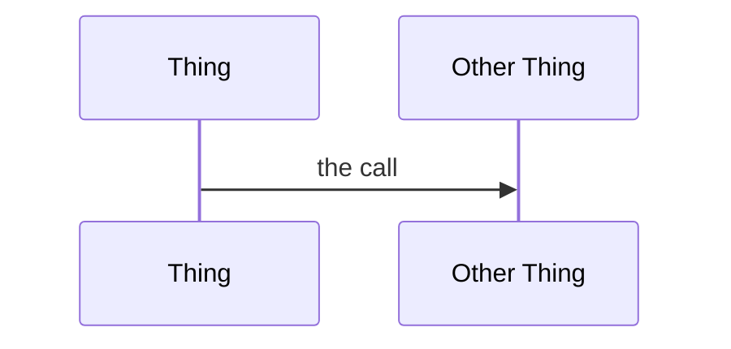

# Lesson Template

Every lesson in this course follows this shape exactly. Copy this file, rename it,
and fill it in. If a section doesn't apply, say why rather than deleting it —
"not applicable, this lesson is purely conceptual" is information.

## File layout

```
phases/NN-phase-slug/NN-lesson-slug/
├── docs/en.md          the lesson (this structure)
├── code/               runnable implementation, if any
└── quiz.json           machine-readable checks, if any
```

The path is the URL: `/lesson?path=phases/02-git-deep/12-commit-is-a-photograph`

---

## The structure

```markdown
# Lesson Title

> One line. What is different after this lesson that wasn't before.

**Type:** Learn | Build
**Prerequisites:** Phase NN, Lesson NN
**Time:** ~30 minutes

## Learning Objectives

- A thing you will be able to DO, phrased as an action
- Not "understand X" — "use X to do Y"
- Three to five of them

## The Problem

Open with consequence, not definition. What breaks, what it costs, what
happens if you don't have this. If the reader has never felt the pain,
make them feel it in a sentence.

## The Concept

The idea itself. Mermaid diagrams for anything with flow or structure.



Named the way people actually name it. Then the reframe — the sentence that
makes it click.

## Build It

Numbered steps. Runn## Use It

A scannable table. Command or concept | when you reach for it.

No theory by this point. This is the reference you come back to.

## Exercises

Numbered. Each has a success criterion — the observable state that means
you got it. "✅ You pass when the file is back and `git status` is clean."

1. Do the thing
   ✅ You pass when ...

## Key Terms

| Term | What people say | What it actually means |
|------|-----------------|------------------------|
| X | "the wrong intuition" | the accurate definition |

The second column names the misconception in the same breath as the correction.
This is the highest-value table in the lesson. Never skip it.
```

---

## Rules

**Ground before leaning.** A lesson may only use concepts an earlier lesson
established. If you need a term a reader hasn't met, link back to where it was
taught. Forward references are the single biggest cause of a reader falling off.

**`Type:` is honest.** `Learn` for concepts, `Build` for construction. If it's
mostly one, say so. A `Build` lesson with no runnable artifact is lying.

**Every exercise gets a criterion.** Without one, "done" is a feeling, and
feelings don't compound.

**One reframe per lesson.** Not ten. The sentence that makes it click, singular.
If you can't find it, the lesson isn't finished.

**Cite, don't assert.** Version-gated claims drift — Claude Code ships weekly.
Link the page and teach the concept rather than quoting behaviour as permanent.

**Say what's skipped.** If a lesson deliberately doesn't cover something, name it
and say when to come back. Silence reads as oversight.

---

## Writing voice

Plain words. Fragments fine. Short sentences when the idea is hard.

Bad:  "The worktree abstraction provides isolation for concurrent modification."
Good: "Each agent gets its own folder. Nobody steps on anyone."

No hedging, no filler, no "it's important to note that". If it matters, the
reader can tell.