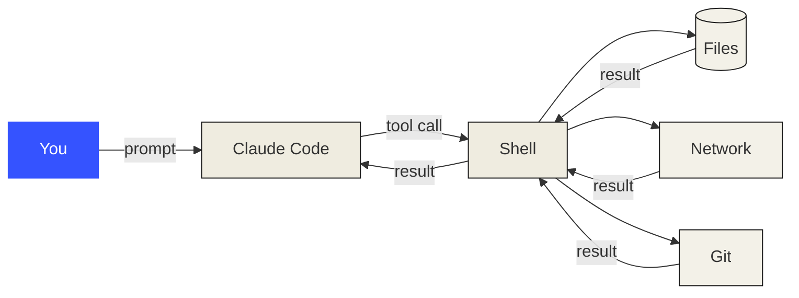

# Dev Environment

> Your tools shape your thinking. Set them up once, set them up right.

**Type:** Build
**Prerequisites:** none
**Time:** ~30 minutes

---

## Learning Objectives

By the end of this lesson you will be able to:

- Say where an agent can and cannot act, and why that comes from one choice
- Get your bearings in an unfamiliar directory in under a minute
- Verify your tools are actually installed, not merely present on `PATH`
- Trace any setting back to the file that supplied it

---

## The Problem

You install Claude Code once. Then you spend an afternoon debugging it and never
suspect the install.

Wrong directory. Wrong shell. A tool that exists but isn't real. Every later
lesson assumes setup worked — so when it didn't, the failure surfaces thirty
minutes into a lesson about something else, and you blame the wrong thing.

Here are three real ones, from building this course. Each looked like a tool bug.
Each was fixed in under a minute once you knew where to look.

**The session that refused to start.** A feature that gives agents their own
copies of a repository reported *"not in a git repository"* while `git rev-parse`
in the same directory returned `true`. The
harness had checked the directory at launch, found nothing, cached the answer,
and never checked again. **Twenty minutes gone** — and no amount of re-reading
the docs would have found it. The documentation was correct. The tool was
correct. The timing was wrong.

**The failing build that wasn't.** After a clean merge of three agents' work, the
test suite went red. It read like total failure. It was a wrong glob in
`package.json`. **Nine pass, zero fail after a one-character fix.** Trusting a red
suite without checking the runner first means throwing away good work.

**The setting that did nothing.** You edit a config file, restart, and the
behaviour is unchanged. You edit it harder. The problem is that four other places
also set that key, and one of them wins.

Every one of these presented as a bug in the tool. Every one lives in your
environment. **Forty minutes of setup now, or an hour of confusion per lesson for
the rest of the course.**

> **Sharpen this with your own scars.** These three are real, but they're mine. If
> you've lost an afternoon to a config problem or a wrong-directory incident,
> that story lands harder than anything here. Write it into this section.

---

## The Concept

An agent has one way to touch the world: a **shell**. A shell is the program that
reads your typed commands and runs them. Files, network, git — everything routes
through it.



**The reframe: you are not setting up a machine, you are choosing which directory
an agent is allowed to act inside.** Every downstream boundary — what it may
touch, what it may change, what it may reach — inherits that one choice.

This is why the wrong directory is so expensive. An agent launched in your home
directory and one launched in a single project are the same program with
different blast radius.

---

## Build It

### Step 1: Get your bearings

```bash
cd /path/to/this/repo
pwd            # absolute path — you are here
ls -a         # all files including dotfiles: .claude, .git, .gitignore
git status    # is anything uncommitted?
```

Read all three. Before an agent touches a directory, you should be able to answer
*where am I*, *what's here*, and *is it safe to change anything* — without
scrolling.

### Step 2: Verify the tools

```bash
bash code/setup-check.sh
```

Prints what's present, what's missing, and whether your config files exist.
Exits `0` when ready, `1` when not.

**If it reports `Missing: claude`, install it now.** Every step after this one
assumes it exists. Docs: <https://code.claude.com/docs/en/quickstart>

It also catches a trap worth knowing. On Windows, `python3 --version` can print
*"Python was not found"* and **still exit 0** if you have the Microsoft Store
shim. A tool that is on your `PATH` but not installed is worse than one that's
absent — you don't know to fix it. **Presence is not correctness.**

### Step 3: Find your config, and know which one wins

Claude Code reads configuration from **five layers** — four files and one command-line
flag. Highest wins.

| # | Where | Who it affects |
|---|---|---|
| 1 | Managed settings (your organisation) | Everyone |
| 2 | `--settings` flag | You, this session |
| 3 | `.claude/settings.local.json` | You, this project only |
| 4 | `.claude/settings.json` | Everyone in the project |
| 5 | `~/.claude/settings.json` | You, every project |

```bash
ls -a .claude/
cat .claude/settings.json      # committed, shared
cat ~/.claude/settings.json    # yours, everywhere
```

**Two rules when the same key appears twice:** arrays (lists) merge across
layers; scalars (single values) are replaced by the higher one.

### Step 4: Write your CLAUDE.md

`CLAUDE.md` is a plain markdown file at your project root. Claude Code reads it
at startup, before your first prompt is answered. It is where you say things
that would otherwise be rediscovered every session.

Write it in whatever editor you have:

```markdown
# my-cli

Wraps the internal build tool. Not a general-purpose CLI.

## Commands

- Install: `npm install`
- Test: `npm test`

## Conventions

- `src/parser.ts` is generated. Never hand-edit it.
```

Note what's *not* there: no preamble, no philosophy, no aspirational guidance.
Three sections and specific commands beat thirty lines of prose.

**Keep it short.** Every session pays to read it. Once it's more than a couple of
screens, the agent starts skipping it and you end up verifying its claims anyway.
If it's genuinely large, the answer is a separate reference file it can open on
demand — a lesson for later.

### Step 5: Prove it works

Inside Claude Code, type a command starting with `/`. These are **slash
commands** — actions the tool provides, typed at the prompt.

```
/status
```

It prints a line telling you which file supplied each setting. **Check this
before editing any config file.** Usually the setting you're editing isn't the
layer that won.

Then ask:

```
What are the commands in this project, and where did you get them?
```

If it answers from `CLAUDE.md`, setup works. If it guesses generically, your file
is missing, too vague, or too long.

---

## Use It

| Command / file | When you reach for it |
|---|---|
| `pwd` | First thing, every session — you must know where you are |
| `git status` | Before and after anything an agent does |
| `bash code/setup-check.sh` | First thing in a new repo |
| `/status` | "Why isn't this setting working?" |
| `CLAUDE.md` | Once per project. Then maintain it |
| `.claude/settings.json` | Shared project config — commit this |
| `.claude/settings.local.json` | Your own overrides — don't commit |

---

## Exercises

1. Run `bash code/setup-check.sh` and read every line of output.
   ✅ You pass when it prints `Result: ready.` and `echo $?` prints `0`.

2. Run `/status` and find which file supplied a setting you care about.
   ✅ You pass when you can name the actual file path, not recite the precedence
   order from memory.
   *If nothing is set, add a `model` key to `.claude/settings.local.json`,
   restart, and run it again.*

3. Write a `CLAUDE.md` for a real project of yours — filled in, not a skeleton.
   ✅ You pass when every command in it is one you would actually type, and no
   line is there only because a template had a heading for it.

---

## Key Terms

| Term | What people say | What it actually means |
|---|---|---|
| **Shell** | "The terminal" | The program that runs your commands. The agent's only path to your files, network, and git |
| **Working directory** | "The project folder" | The one directory an agent is scoped to. Every boundary starts here |
| **Settings precedence** | "Config" | Five layers. Highest wins; arrays merge, scalars are replaced |
| **Slash command** | "A command" | An action typed at the prompt beginning with `/` |
| **CLAUDE.md** | "Config" | Markdown read at startup, before your first prompt |
| **Managed settings** | "Admin config" | Settings your organisation enforces; you cannot override them |

---

## What this lesson skipped

Editor and shell configuration are yours — this course never assumes one. Windows
users: Git Bash or WSL both work; the commands here are the same either way.

Installing Claude Code itself is in the quickstart, linked in Step 2. Containers
are for much later, if ever.

---

## Related

- Next: **Git & Collaboration** — the safety net everything after depends on
- Later: Phase 04 — the full settings reference and every key
- Later: Phase 08 — automating the checks you just learned to run by hand