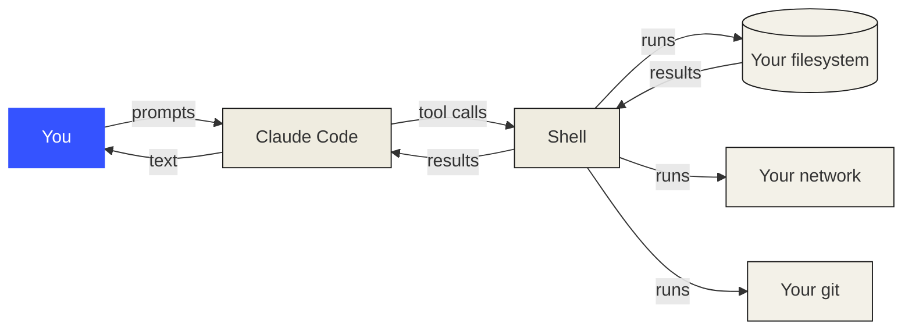
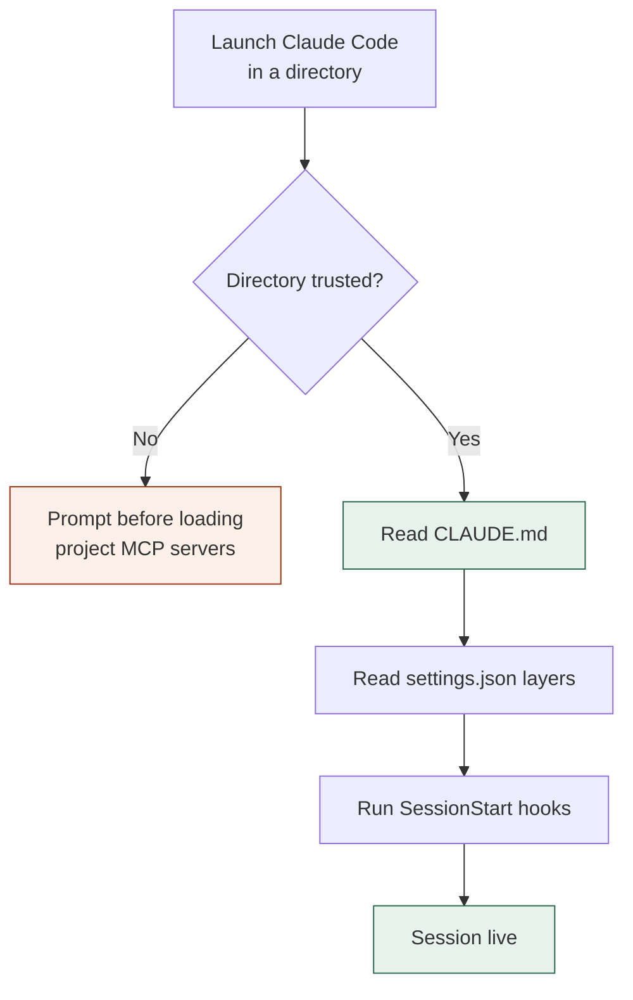

# Dev Environment

> Your tools shape your thinking. Set them up once, set them up right.

**Type:** Build
**Prerequisites:** none
**Time:** ~30 minutes

---

## Learning Objectives

By the end of this lesson you will be able to:

- Explain why environment setup is a *thinking* concern and not a chore
- Start a terminal in any directory and get your bearings in under five seconds
- Verify that the tools this whole course depends on are present and correct
- Set up `CLAUDE.md`, which makes every later lesson work better

---

## The Problem

An agent does not read your mind. It reads the directory you launched it in, the
files in that directory, and the instructions in `CLAUDE.md`. If those three
things are unclear, the agent is not being difficult — it is guessing, and you
are the only one who can tell it's guessing.

Here is what that costs, from building this course. Three failures that all looked
like the tool being broken, and all were environment problems:

**The session that refused to start.** A worktree tool reported *"not in a git
repository"* while `git rev-parse` in the same directory returned `true`. The
harness had probed the working directory at launch, found nothing, cached the
answer, and never checked again. The fix was to restart. **Twenty minutes
gone, and no amount of re-reading the docs would have found it** — the
documentation and the tool were both correct; the timing was wrong.

**The failing build that wasn't.** After a clean merge of three agents' work,
the test suite went red. It read like total failure. It was a wrong glob in
`package.json`. **Nine pass, zero fail after a one-character fix.** If you trust
a red suite without checking the runner first, you throw away good work.

**The setting that did nothing.** You edit a config file, restart, and the
behaviour is unchanged. You edit it again, harder. The problem is that four
other files also set that key and one of them wins. **`/status` tells you which
one in a single line.** It is the most under-used command in the tool.

Notice what these have in common: **each one presented as a bug in the tool, and
each was fixed in under a minute once you knew where to look.** The environment
is where that knowledge lives. Set it up badly and every later lesson costs you
an hour of debugging your own setup.

---

> **Sharpen this with your own scars.** The three above are real, but they're
> mine. If you've lost an afternoon to a config problem, a wrong-directory
> incident, or a tool that silently didn't work, that story is sharper than
> anything here — write it into this section. A lesson's Problem section is
> worth most when the pain is recognisable to *you*.

---

## The Concept

An agent works through your shell. Every file it reads, every command it runs,
every test it executes goes through the terminal you gave it. You are not
configuring a workspace — you are configuring **the hands you think with**.



Two properties of this diagram do most of the work in this course:

**Everything routes through the shell.** There is no side channel. Whatever your
shell can do, the agent can do — including the things you did not want it to do.

**You are in the loop, twice.** Once when you choose the working directory (that
choice sets every boundary), and once in `CLAUDE.md` (that file is read into
context before your first prompt is answered).

That second loop is the one people miss. Most people configure their terminal
carefully and then wonder why the agent keeps doing the same thing wrong. It was
never the terminal.



**The reframe:** you are not setting up a machine, you are choosing which
directory an agent is allowed to act inside. Everything downstream — permissions,
isolation, safety — inherits that choice.

---

## Build It

### Step 1: Open a terminal in this repo

```bash
cd /path/to/this/repo
pwd          # prints the absolute path — you are here
ls -a       # including dotfiles: .claude, .git, .gitignore
git status   # tells you whether the tree is clean
```

**Read those three outputs together.** `pwd` says where. `ls -a` says what's here.
`git status` says whether it's safe to change anything. Before an agent touches a
directory, you should be able to answer all three without scrolling.

### Step 2: Verify the four tools this course needs

```bash
git --version
node --version      # or python3 --version, if you prefer
claude --version
```

Any of these missing is fine — the course adapts. But know which, because a
lesson that assumes `node` and silently assumes it is a bad lesson.

### Step 3: Find your config, and know which one wins

Claude Code reads four settings files. Knowing the order saves real debugging:

| Precedence | File | Who it affects |
|---|---|---|
| 1 (highest) | `managed-settings.json` | Your organization |
| 2 | `claude --settings` | You, this session |
| 3 | `.claude/settings.local.json` | You, this project only |
| 4 | `.claude/settings.json` | Everyone in the project |
| 5 | `~/.claude/settings.json` | You, every project |

Inside a session, `/status` prints a **Setting sources** line telling you exactly
which file supplied each value. Use it before you guess.

```bash
ls -a .claude/                 # project-level
cat .claude/settings.json      # committed, shared
ls ~/.claude/settings.json     # user-level
```

### Step 4: Write your CLAUDE.md

This is the highest-leverage file in the repo, and it is read before your first
prompt is answered.

```bash
$EDITOR CLAUDE.md
```

A starting shape — four sections, keep it under 200 lines:

```markdown
# Project Name

One paragraph: what this is and what it's for.

## Commands

- Install: `<command>`
- Test: `<command>`
- Run: `<command>`

## Conventions

- <the rules a contributor would get wrong by guessing>

## Agent notes

- <anything an agent would otherwise waste turns discovering>
```

**The rule that matters: under 200 lines.** When it grows past that, the content
is reference material, not instructions — move it to a skill and leave a pointer.

### Step 5: Prove it works

Ask the agent something that can only be answered from `CLAUDE.md`:

```
What are the commands in this project, and where did you get them?
```

If it answers from the file, setup works. If it answers from a generic guess,
your `CLAUDE.md` is missing, unread, or too vague.

---

## Use It

| Command / file | When you reach for it |
|---|---|
| `pwd` | First thing, every new session — you must know where you are |
| `git status` | Before and after anything an agent does |
| `ls -a` | Reading a directory that has config in it |
| `/status` | "Why is this setting not working?" — shows Setting sources |
| `claude doctor` | Rejected settings entries, broken config |
| `CLAUDE.md` | Once per project. Then maintain it |
| `.claude/settings.json` | Shared project config — commit it |
| `.claude/settings.local.json` | Your own project overrides — don't commit |

**When you're stuck on a config question:** check `/status` before editing
anything. Nine times in ten, the answer is which layer won, and editing the layer
you *think* is responsible is how settings appear to be ignored.

---

## Exercises

1. Open a terminal, `cd` to this repo, and produce the three outputs from Step 1
   without looking them up.
   ✅ You pass when you can name the absolute path, list the dotfiles, and state
   whether the tree is clean — in under 30 seconds.

2. Run `/status` and identify which file supplied your `model` setting.
   ✅ You pass when you can point at the actual file path it names, not guess
   the precedence order from memory.

3. Write a `CLAUDE.md` for a project of yours with all four sections, then delete
   the least useful section.
   ✅ You pass when you can say what you removed and why it didn't earn its place.
   (This one is about subtraction, not writing.)

4. Get an agent to answer a question using *only* your `CLAUDE.md`.
   ✅ You pass when the agent cites your file rather than generalizing.

---

## Key Terms

| Term | What people say | What it actually means |
|---|---|---|
| **Working directory** | "The project folder" | The one directory an agent is scoped to. Every boundary starts here |
| **Settings precedence** | "Config" | Five layers. The highest layer that sets a key wins; arrays merge, scalars override |
| **Workspace trust** | "Permission" | Whether you've agreed to let this directory's MCP servers run |
| **Project trust** | "Permission" | *Same mechanism.* The docs use both words — a rename in progress |
| **CLAUDE.md** | "Config" | Instructions read into context before your first prompt is answered |
| **Shell** | "The terminal" | The only path between the agent and your filesystem, network, and git |

---

## What this lesson skipped

- **Editor configuration.** Matters, doesn't affect the agent's behaviour.
- **Shell customisation.** Aliases and prompts are yours. This course will never
  assume one.
- **Containerised dev.** Right answer for some teams, wrong default for learning.

Come back for containers in Phase 17 (Scaling & Operations), if at all.

---

## Related

- Next: **Git & Collaboration** — the safety net everything after depends on
- Later: Phase 04 **Settings** — the full precedence rules and every key
- Later: Phase 08 **Hooks** — automating the checks you just learned to run by hand