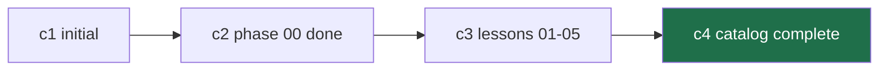

# Git & Collaboration ← your safety net, not optional

> After this lesson you can get any piece of work back with one command, even
> when an agent deleted it, overwrote it, or went sideways.

**Type:** Learn
**Prerequisites:** Lesson 1, Dev Environment
**Time:** ~45 minutes

---

## Learning Objectives

- Explain what a commit actually stores, in one sentence you could say out loud
- Put work back after deleting a file, overwriting it, or wrecking a directory
- Recover work that was never committed — the case that surprises everyone
- Commit on a branch, switch branches, and get back — without fear

---

## The Problem

An agent edits six files. Three are wrong and it did not say which. You revert
the whole change by reflex and lose two hours of work that was actually good.

That reflex comes from one belief: **"a commit is a save button that only keeps
the last thing."** Once you believe a commit is a full snapshot of the whole
project, the recovery is trivial — and so is the decision not to revert
everything.

This lesson exists because later phases run several agents at once. Isolation
without commits is not a backup. We hit exactly that bug here: three agents did
perfect work in separate folders and none of them committed. All of it lived as
loose files on disk, one bad command from gone. Nothing to merge, because the
branches were empty labels pointing at the same commit.

---

## The Concept

A commit is a **photograph of your entire project at one moment, with a name you
chose.**

Not a diff. Not a list of edits. The whole tree, frozen.



You are standing at `c4`. `c3` is still there, one command away, forever. You
cannot lose work with git. You can lose *time* — which at 2am feels identical,
and is why the habit matters.

> **The reframe:** a commit is not a save button, it is a photograph — and
> photographs you don't take are the only thing that can actually be lost.

### The two words that cause all the confusion

| Word | What it is | Analogy |
|---|---|---|
| working tree | The live folder on disk. Where unsaved edits sit. Fragile. | Your desk |
| commit | One frozen snapshot in permanent history. | A photograph in a drawer |

An agent editing a file changes the working tree. That is the dangerous state —
nothing is recorded. A commit is what makes it safe. Everything later in this
course is a variation on "make it safe before letting go."

### Branches are labels, not copies

A branch is a **movable label pointing at one commit**. Creating one copies
nothing, costs nothing, takes no time. It is an arrow.

```bash
git branch feature-a     # instant, regardless of project size
```

This matters for agents later: spinning up isolated work is cheap, and staying
*inside* it is your job. Nobody will do it for you.

### The safety rules

Four habits. Every one of them is about making work recoverable.

1. **Commit before you let go.** Before a risky command, before a context
   switch, before an agent does something large.
2. **One commit per coherent change.** Not per file, not per session.
3. **Never work directly on `main`.** Branch first. It costs one keystroke.
4. **Write the commit message for a stranger.** It's you in six weeks.

---

## Build It

Run these in the lab repo from Lesson 1. Every step ends in something visible.

### 1. Take a photograph, then destroy it

```bash
cd ~/claude-course-lab
printf 'export const greet = (n) => `hi ${n}`\n' > src/greet.ts
git add -A
git commit -m "feat: add greet"
git log --oneline
```

Now delete the file you just made and prove it was never really gone.

```bash
rm src/greet.ts
ls src/                 # greet.ts is gone
git checkout -- src/greet.ts
ls src/                 # back
```

✅ You pass when `src/greet.ts` exists again after being deleted.

### 2. Wreck a whole directory and walk back

```bash
mkdir -p src/experiment && echo "v1" > src/experiment/a.txt
echo "v2" > src/experiment/b.txt
git add -A && git commit -m "chore: experiment"

echo "v3" > src/experiment/a.txt
rm src/experiment/b.txt
git add -A && git commit -m "chore: break the experiment"

git log --oneline            # two commits
git revert HEAD              # undo, keeping history
git log --oneline            # three commits, newest says "Revert"
ls src/experiment/           # both files, v1 and v2
```

✅ You pass when both files are back at their original contents.

### 3. The case that surprises everyone — recover uncommitted work

This is the one that saves people. Work that was **never committed** is not
lost, as long as you haven't run a destructive command.

```bash
echo "important half-finished work" >> src/index.ts
git status                  # modified: src/index.ts

# now something goes wrong
echo "garbage" >> src/index.ts
# and you still want that earlier edit:
git diff src/index.ts       # shows BOTH edits, side by side
```

And if you did overwrite the file completely, the editor's local history or your
shell's undo usually still has it. Git never had it — but the tool that clobbered
it usually does.

✅ You pass when `git diff` shows both the original and your addition.

### 4. Branch, work, come back

```bash
git branch scratch
git checkout scratch
echo "experimental" > src/scratch.txt
git add -A && git commit -m "chore: on scratch"

git checkout main          # or master, depending on your default
ls src/                    # scratch.txt is not here — and that's correct

git checkout scratch
ls src/                    # it's back
git checkout main
git branch -d scratch
```

✅ You pass when `scratch.txt` appears only while you're on `scratch`.

### 5. The commit-message test

Look at your last three commits. If you can't tell from the message alone what
changed and why, rewrite the message:

```bash
git rebase -i HEAD~3
```

✅ You pass when each message alone explains the change without opening a diff.

---

## Use It

| Command / concept | When you reach for it |
|---|---|
| `git status` | Before anything risky. Tells you what's uncommitted. |
| `git add -A && git commit -m "..."` | Before handing work to an agent, or before a risky command |
| `git log --oneline` | Finding the last good state |
| `git revert <sha>` | Undoing a bad commit while keeping history honest |
| `git checkout -- <file>` | Restoring one file you deleted or overwrote |
| `git diff` | Seeing uncommitted work, including the pre-overwrite version |
| `git branch` / `git checkout` | Isolating an experiment so `main` stays clean |
| `git branch -d` | Cleaning up a merged branch |
| `git rebase -i HEAD~N` | Fixing commit messages on recent commits |

---

## Exercises

1. Delete a file you have **not** committed, then recover it.
   ✅ You pass when the file is back with its original content, and you can name
   which command did it.

2. Make three commits. Revert the middle one. Then read the history top to
   bottom and confirm the middle change is gone and the other two survived.
   ✅ You pass when `git log --oneline` shows the revert and `git diff` against
   the original tip shows only the reverted change missing.

3. Start a new branch, break `main` deliberately on it, and return to `main`
   untouched.
   ✅ You pass when `main` shows a clean `git status` and the broken file does
   not exist there.

4. Write a commit message that would make sense to someone reading it in six
   weeks with no context.
   ✅ You pass when you can name the change and its reason from the message alone.

---

## Key Terms

| Term | What people say | What it actually means |
|---|---|---|
| commit | "save point", "snapshot of changes" | A frozen copy of the **entire project** plus a message. Changes are not stored; the whole tree is. |
| working tree | "my files" | The live folder. Fragile. Nothing you do here is recoverable through git until you commit. |
| branch | "a copy of the project" | A movable label pointing at one commit. Creating it copies nothing. |
| `git revert` | "undo" | Adds a new commit that undoes an old one. History stays; the mistake stays visible. |
| `git checkout -- file` | "get it back" | Restores one file from the last commit. Destroys uncommitted changes to that file. |
| isolation | "safety" | A separate working tree on a separate branch. Safe **only once committed** — until then the work exists as loose files. |

---

## What this lesson skipped

No merging two branches with real conflicts, no rebasing onto other branches, no
remotes or pull requests — Phase 02 covers all of that properly, and this lesson
must not lean on it.

No undo for a `git reset --hard` that destroyed uncommitted work. Git genuinely
cannot recover that. Say so out loud once: **uncommitted work is the only work
git cannot bring back.** That is the entire reason for the first safety rule.

---

**One thing to carry into every later phase:** always tell an agent to commit its
work. Isolation without a commit is not a backup.