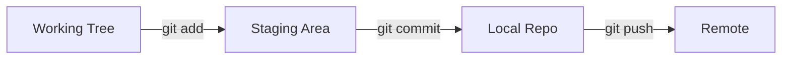

# Git as Your Safety Net

> "The agent just rewrote six files and three of them are broken." — every developer, eventually.

**Type:** Learn
**Prerequisites:** Lesson 1 (Dev Environment)
**Time:** ~45 minutes

## Learning Objectives

By the end of this lesson, you will be able to:

- Describe the four states a file can be in: working tree, staging area, local repository, remote.
- Move files between these states without fear.
- Recover lost work using git's history.
- Set up a remote so a local disaster cannot end the project.

## The Problem

You ask the agent to refactor a function. It edits five files. Three of them no longer compile. The original code is gone — overwritten in place, no backup, no undo button. You stare at the screen and think: "what did it look like before?"

This is the cost of giving an AI agent write access to your code. The agent is fast. The agent is not always right. When it is wrong, it can destroy work in seconds.

If your only safety net is "undo in the editor" or "I remember what I wrote," you are a single bad agent run away from losing a day.

## The Concept

Git is not primarily a collaboration tool. For solo work with an AI agent, git's primary job is to be the safety net that lets you move between past and present without fear.

**The reframe:** Most people think of git as a way to share code with other developers. For AI-agent work, git is the record of every change an agent has made to your code, plus the ability to roll any of them back. Every later lesson in this course assumes you can recover lost work. That ability lives in git.

A file in a git project lives in one of four states:

1. **Working tree** — the files on disk, as your editor sees them. The agent edits here. Changes in the working tree are not yet saved.
2. **Staging area** — a snapshot of selected working-tree files, ready to be saved as one unit. This is a holding pen, not a backup.
3. **Local repository** — the saved history on your machine, stored in a hidden `.git` directory. Once a change is here, it is recoverable. This is the safety net.
4. **Remote** — a copy of the history on another machine, such as GitHub. This is insurance against losing your laptop.

The flow moves in one direction: working tree to staging area to local repository to remote.



The key mental shift: every agent run that changes a file should end with a commit. If the change is wrong, you roll back the commit. If the commit is good, you push it to the remote.

Three commands you must internalize:

- `git status` — what is in which state right now.
- `git diff` — exactly what changed since the last commit.
- `git restore <file>` — return a working-tree file to its last committed state.

## Build It

Set up a git project you will use for the rest of this course.

1. Open your terminal in the directory from Lesson 1.
2. Initialize a git repository:

   ```
   git init
   ```

3. Configure your identity. Git refuses to commit without one:

   ```
   git config --global user.name "Your Name"
   git config --global user.email "you@example.com"
   ```

4. Create a file:

   ```
   echo "Lesson 2 test" > notes.txt
   ```

5. Check the state:

   ```
   git status
   ```

   `notes.txt` is listed as **untracked** — it lives in the working tree but git has not been told to remember it.

6. Move it to the staging area:

   ```
   git add notes.txt
   ```

7. Save it to the local repository:

   ```
   git commit -m "First commit"
   ```

8. Confirm the commit exists:

   ```
   git log
   ```

   You should see one entry, with your name, your email, and the message.

## Use It

Walk a file through all four states, then prove you can recover it.

1. Edit `notes.txt` — add a second line.
2. Run `git status`. The file is listed as **modified**.
3. Run `git diff`. Read the output. This is your window into what changed. Use it after every agent run.
4. Run `git add notes.txt`. The change moves to the staging area.
5. Run `git commit -m "Add second line"`. The change is now in the local repository and recoverable.
6. Run `git log --oneline`. You should see two commits.

Now simulate the recovery you will need later:

1. Edit `notes.txt` — delete the entire contents and save.
2. Run `git status`. The file is **modified**.
3. Run `git restore notes.txt`. The file is back to its last committed state.
4. Run `git status`. The working tree is clean again.

This is the safety net in action. The agent destroyed your work, and one command brought it back.

Now set up a remote so a disk failure cannot end the project:

1. Create an empty repository on GitHub. Do not initialize it with a README.
2. Connect your local repo to it:

   ```
   git remote add origin https://github.com/YOUR-USER/YOUR-REPO.git
   ```

3. Push your commits:

   ```
   git push -u origin main
   ```

4. Open the repository on GitHub. Your two commits should be visible there.

## Exercises

1. **The accidental deletion**
   Edit `notes.txt` and add three new lines. Commit the change. Now delete the file entirely from disk. Recover it using git. Do not re-type the contents.
   Pass: the file is back on disk with all the lines you added, and `git log` still shows your commit.

2. **The bad agent run**
   Have Claude Code rewrite `notes.txt` in a way that loses information — for example, by deleting a paragraph you care about. Then roll the change back so the original content returns.
   Pass: the original content of `notes.txt` is restored, and either `git log` shows both the bad commit and a revert commit, or the bad commit no longer exists in history. Either outcome is acceptable.

3. **The remote backup**
   Make a third change to `notes.txt`, commit it, and push it. Then delete the `.git` directory locally. Re-clone the repo from the remote.
   Pass: the cloned repo contains all three of your commits, and `notes.txt` is intact.

4. **The unstaged disaster**
   Make a change to `notes.txt` but do not commit it. Now imagine your disk fails at this moment. What state is your work in, and why?
   Pass: you can answer in one sentence: the change was only in the working tree, and git cannot recover it because it was never committed. Commit early. Commit often.

## Key Terms

| Term | What people say | What it actually means |
|---|---|---|
| Working tree | "The folder where my code is." | The files on disk right now, as your editor sees them. Uncommitted changes live here and only here. |
| Staging area | "A place to review changes before committing." | A snapshot of selected working-tree files, prepared for the next commit. The staging area is not a backup — it is a holding pen. |
| Local repository | "Where commits are stored." | A database on your machine that records every commit. This is the safety net. Once a change is committed, it is recoverable until you delete the `.git` directory. |
| Remote | "Where I push code so others can see it." | A copy of your repository on another machine. For solo AI-agent work, the remote is insurance against losing your laptop, not a way to collaborate. |
| Commit | "A saved change." | A snapshot of specific files at a specific moment, with a message describing why. Commits are the unit of recovery. |
| `git restore` | "Undo." | Reverts a working-tree file to its state at the last commit. Use it when an agent — or you — has wrecked something and you want the last known-good version. |

## What this lesson skipped

- **Branching and merging.** Branches isolate work, but for solo AI-agent use, linear commits on `main` are enough to start. Branches become important when multiple agents or features compete, which is a later lesson.
- **Merge conflicts.** These appear when two histories diverge. With one developer and one agent, conflicts are rare until you start branching.
- **Pull requests and code review.** Collaboration patterns, not safety-net patterns. Solo AI-agent work does not need them.
- **`git rebase` and history rewriting.** Powerful, and also a way to destroy commits. Beginners should commit often, and rewrite history only when they know what they are doing.
- **`.gitignore`.** A way to keep generated files out of the repository. One line worth knowing: anything git does not track cannot be recovered by git. Track everything that matters.
