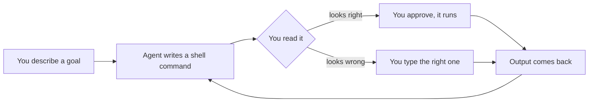

# Terminal and Shell

> After this lesson you can read what the agent is about to do, decide if it is right, and run it yourself when it is wrong.

**Type:** Learn
**Prerequisites:** Lesson 1, Dev Environment
**Time:** ~35 minutes

## Learning Objectives

- Read any shell command the agent proposes and name the file it will touch
- Run the same command yourself before letting the agent run it
- Predict the difference between `>` and `>>` in a command the agent shows you
- Recover from a wrong agent command by typing the right one yourself
- Name three shell commands an agent reaches for on every task

## The Problem

Two hours into a session the agent says "I'll delete the tests folder." You approve. It was the wrong folder. The work that lived there — including yesterday's draft, never committed — is gone.

You had a chance to catch this. The command was on the screen. You were reading the prose, not the command.

The shell is not a separate skill. **The agent runs every action through a shell.** When you ignore the shell, you trust the agent to be right about a language you have never read.

## The Concept

The agent does not have a private channel. Every action it takes — reading a file, listing a directory, running tests, editing code — arrives as a shell command on your screen before it runs. You see it. You can copy it. You can run it yourself first.

One concept, three corollaries.



The middle box — *you read it* — is the only skill this lesson teaches. Everything else is supporting muscle.

### Corollary 1 — the commands are ordinary

The verbs an agent reaches for are the ones you already know how to read.

| What the agent is doing | The shell verb it uses |
|---|---|
| Reading a file | `cat`, `head`, or a tool that wraps one |
| Listing a directory | `ls` |
| Searching code | `grep -rn` |
| Editing a file | `sed -i`, here-docs, or a tool that writes it |
| Running tests | `npm test`, `pytest`, `go test` |
| Inspecting git state | `git status`, `git diff` |
| Deleting something | `rm`, `rm -rf` |

None of these are hidden. None are special. They are the same commands you would type.

### Corollary 2 — overwriting is a one-character mistake

The single character `>` overwrites. `>>` appends. The agent almost never means overwrite when it types `>`. Read for it.

```bash
echo "# Contributing" > CONTRIBUTING.md     # replaces if it exists
echo "## Setup" >> CONTRIBUTING.md          # adds to the end
```

### Corollary 3 — the agent's working directory is yours

A `cd` inside the agent's tool call affects only that call. The shell prompt you see is the one that matters; if the agent's command has no `cd`, it runs in the same folder you are in. Check with `pwd` if you are unsure.

> **The reframe:** the agent's commands are your commands, written down before they run — so learning the shell is learning to read what the agent is about to do.

## Build It

Do these in the lab repo from Lesson 1.

### 1. Read what the agent would have read

```bash
cd ~/claude-course-lab
cat src/index.ts
```

The agent uses this — or its `Read` tool, which wraps this — every time it opens a file. You have now read the same file the same way.

Pass: you see the contents of `src/index.ts` on your screen.

### 2. Run a search the agent would run

```bash
grep -rn "sum" src/
```

This is how an agent checks whether a name is already taken. Read it as: *search every file under `src/`, print the file name and line number for every line containing `sum`*.

Pass: you see file paths and line numbers, not raw blobs.

### 3. Append to a file from the terminal

```bash
echo 'export const double = (x) => x * 2' >> src/index.ts
cat src/index.ts
```

Notice the `>>`, not `>`. If you had typed `>` the old content is gone. This is the difference between a one-character typo and data loss.

Pass: the original `sum` line is still there and a new `double` line was added.

### 4. Catch a wrong `rm` before it runs

In a throwaway folder, type — but do **not** press enter yet:

```bash
mkdir -p /tmp/sandbox && cd /tmp/sandbox && echo hi > keep.txt && echo hi > keep2.txt
rm -rf keep
```

Read it left to right: make a folder, enter it, write `keep.txt`, write `keep2.txt`, then `rm -rf keep`. Predict what remains. Press enter. Confirm your prediction was right.

This is the moment an agent would have approved and moved on.

Pass: you can predict the result before pressing enter, and explain why.

### 5. Predict, then run

For every command in steps 1–4, before pressing enter say out loud: which files will change, which will not, and whether output will appear. Then run it. If reality disagreed with your prediction, that is the lesson. Write the gap in `NOTES.md` inside the lab repo.

Pass: you wrote at least one prediction, ran it, and noted the gap.

## Use It

| Command | When you reach for it |
|---|---|
| `cat file` | Reading what the agent is about to read |
| `grep -rn "x" dir/` | Checking whether a symbol or string already exists |
| `echo "..." >> file` | Appending to a file (notice `>>`) |
| `echo "..." > file` | Replacing a file's contents (notice `>`) |
| `rm file` | Deleting one file |
| `rm -rf dir` | Deleting a directory; `-r` means recursive, `-f` means no confirmation |
| `pwd` | Confirming the agent's working directory is yours |
| `!!` | Repeating the last command (often after `sudo !!`) |
| `Ctrl-r` | Searching command history by typing a few letters |
| `man cmd` or `cmd --help` | Looking up what one flag does |

## Exercises

1. In your lab repo, list the files, read `src/index.ts`, then list the files again. The list is the same — the read did not create anything.
   Pass: you can name three commands the agent runs that are read-only and create no new files.

2. Type `echo "first" > notes.txt`, then `echo "second" >> notes.txt`, then `echo "third" > notes.txt`. Read `notes.txt` after every step.
   Pass: you can state the difference between `>` and `>>` in one sentence, with the final contents of the file as evidence.

3. Pretend an agent proposed `rm -rf src/`. Predict what happens, then run a preview version that only lists what would be removed — `find src -type f` or `ls -R src/` does the job without deleting.
   Pass: you can name one way to preview a destructive command before running it.

4. Open a new terminal tab, run `pwd`, then run `git status`. Both outputs should be from your lab folder. If not, the agent would have worked in the wrong place.
   Pass: both commands report the lab folder.

## Key Terms

| Term | What people say | What it actually means |
|---|---|---|
| shell | "the terminal" | The program that interprets what you type. The terminal is the window; the shell is what runs inside it. |
| command | "a line of code" | One verb the shell runs, with arguments after it. `grep -rn "x" src/` is one command, not five. |
| redirect `>` | "save output" | Overwrite the file on the right with the left side's output. If the file existed, it is gone. |
| redirect `>>` | "append output" | Add to the end of the file. The old contents survive. |
| flag | "option", "switch" | A single-letter or single-word argument after the verb that changes its behaviour. `-r` in `rm -rf` means recursive; `-f` means no confirmation. |
| working directory | "the project folder" | One specific folder a command runs in. The agent inherits yours; if it `cd`s, it does so only inside its own tool call. |

## What this lesson skipped

No pipes beyond `cat`-into-`grep`. No subshells, no job control, no `tmux`, no shell scripting, no quoting rules beyond `>` vs `>>`. If a later lesson needs one of those — particularly subshells, which decide how `cd` survives across an agent's tool call — it will ground it inline. This lesson stays at the level that lets you read the agent's next command before approving it.
