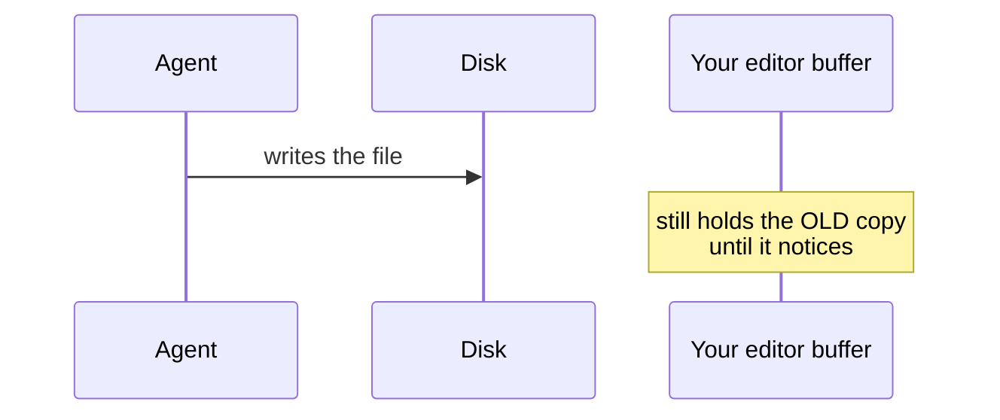

# Editor Setup

> After this lesson, your editor is configured so an agent's edit and your read
> happen in the same place, with no manual refresh.

**Type:** Build
**Prerequisites:** Lesson 1, Dev Environment
**Time:** ~30 minutes

---

## Learning Objectives

- Open your project from your editor so the file tree, the terminal and the agent
  all point at the same folder
- Turn on a diff view so you can see exactly what an agent changed
- Set up save-on-focus-change so you never lose an edit to a stale buffer
- Configure line-length and format-on-save so generated code matches your style

---

## The Problem

You are reviewing an agent's edit across four files. Your editor shows the old
content. You scroll, refresh, close the tab, reopen it. Sometimes it updates.
Sometimes it doesn't, and now you cannot tell whether you are looking at stale
content or at the actual current file.

Then you make a small edit yourself without noticing the agent also just changed
that region, and you save. Your buffer wins. The agent's change is gone. It is not
in history — it was never committed. Lesson 2's safety net does not cover this,
because git only sees what reached disk.

The expensive part is not the lost edit. It is that you cannot tell a stale file
from a real one, so you stop trusting your own screen. That is the whole problem.

---

## The Concept

An editor is a *view of files on disk*. Everything an agent does goes to disk.
Your buffer is a copy of that file held in memory, and the two drift apart the
moment either side writes.

Three settings close that gap, and they are the entire lesson.

**1. Auto-reload on external change.** The editor notices the file changed
underneath it and reloads. Most editors default this on; several do not.

**2. A diff view for external changes.** Rather than silently swapping content,
show a side-by-side diff and let you accept or reject. This is the single highest
value setting in this lesson.

**3. Format on save.** Agents write in their own style. Formatting on save means
the diff you review is about the *logic*, not about whether the agent used two
spaces or four.

> **The reframe:** your editor and your agent are both writing to the same file,
> and the editor is the one that is usually wrong — it is holding a copy from
> before.

---

## Build It

The exact keybindings differ per editor; the *settings* do not. Take VS Code as
the concrete example, translate to yours.

1. **Open the project root, not a subfolder.** In your editor: File → Open Folder
   → the folder containing `.git`.
   ✅ You see the same top-level entries your terminal's `ls` shows.

2. **Enable auto-reload.** Search settings for `files.autoReload` and set it to
   `onFocusChange` (VS Code) or the nearest equivalent.
   ✅ You edit a file from the terminal with `echo x >> notes.txt`, switch back to
   the editor, and the change is already visible.

3. **Turn on the diff view.** Search for `diffOnChange` / "auto compare" and enable
   it.
   ✅ Change a file from the terminal, switch to the editor, and you see a diff
   with accept/reject rather than the file silently changing.

4. **Format on save.** Search for `editor.formatOnSave`, enable it, and set a line
   length of 80 or whatever your project already uses.
   ✅ Open a file with bad indentation, save it, and the indentation normalizes.

5. **Check the project's own config first.** Look for `.editorconfig`,
   `pyproject.toml`, or a `format` section in `package.json`.
   ✅ Either you find one — and you follow it, because it outranks your personal
   preferences — or you confirm there isn't one and set your defaults.

That last step is the one people skip. Personal settings in a repo with a shared
config produce diffs nobody asked for.

---

## Use It

| Setting / command | When you reach for it |
|---|---|
| Auto-reload on focus change | Always. Non-negotiable with an agent writing files. |
| Diff on external change | Any time you review agent work. Non-negotiable for lessons 1–4. |
| Format on save | Always. Keeps diffs about logic. |
| `.editorconfig` | Check before setting anything personal. It wins. |
| `git diff` | After every agent edit, regardless of editor. Your editor's diff is not history. |
| Reload window | When you are genuinely unsure whether what you see is current. |

---

## Exercises

1. Catch yourself being wrong.
   Open a file in the editor, then change the *same lines* from the terminal while
   that buffer is open. Switch back.
   ✅ You pass when you see the terminal's version and the editor shows you a
   diff — not a silently replaced file. That is the failure mode this lesson
   exists to prevent.

2. Make the agent's output match your style automatically.
   Ask an agent to write a file. Save it. Check whether indentation was normalized.
   ✅ You pass when `git diff` shows no whitespace-only noise, because the editor
   normalized it before it reached disk.

3. Establish precedence.
   Create a `.editorconfig` in the scratch repo, then confirm your editor obeys it
   over your personal setting.
   ✅ You pass when the project's rule wins and you can say, in one sentence, why
   it should.

4. Build your review habit.
   Perform one agent edit and review it using only `git diff`, with the editor
   closed.
   ✅ You pass when the diff alone is enough to tell you what changed — no editor
   required.

---

## Key Terms

| Term | What people say | What it actually means |
|---|---|---|
| Buffer | "the file" | Your editor's in-memory copy. It is not the file until you save. |
| Auto-reload | "it updates" | The editor re-reads from disk when it regains focus, closing the staleness gap. |
| Diff view | "seeing the change" | A side-by-side before/after you accept or reject, rather than a silent swap. |
| Format on save | "it looks right" | Whitespace is normalized before reaching disk, so diffs carry logic only. |
| Editor trust | "it's fine, I saved" | Trusting a buffer over disk. This is how an agent's edit gets silently overwritten. |

---

## What this lesson skipped

Specific editor choice, keybinding schemes, language-server configuration, and
any editor's advanced features. The settings above are the intersection of what
every editor has. If you already know your editor well, this lesson is thirty
minutes of verification, not learning.

Not covered, and it matters: what to put in a project instruction file so an
agent follows your conventions without you restating them every session. That is
Lesson 65, ten phases from here. For now, your editor's formatting is doing that
work for you.