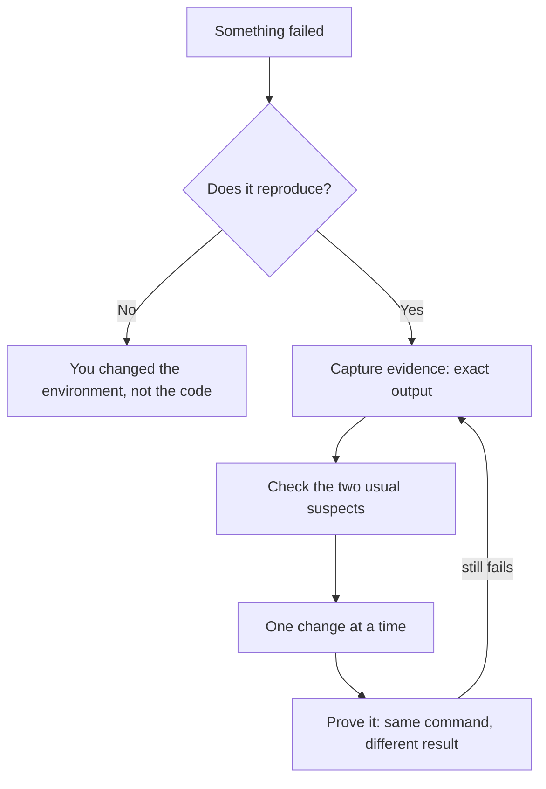

# Debugging & Profiling

> After this lesson you can tell an agent "this fails, here is the evidence" and
> get a fix that works, instead of "it broke, please fix it."

**Type:** Learn
**Prerequisites:** Lesson 3, Terminal & Shell
**Time:** ~40 minutes

---

## Learning Objectives

- Tell the difference between a red test suite and a broken test runner
- Capture a failure as evidence rather than as a description
- Check the two things that are wrong surprisingly often
- Prove a fix fixed the thing, instead of moving it

---

## The Problem

You type: "the tests fail, fix them." The agent edits four files, reports success,
and the suite is still red. Round two, three, four. Each time it changes
something; nothing converges.

Nothing about the agent was incompetent. The prompt was. "The tests fail" is a
**description**. A description cannot be acted on — the agent has to guess which
of a thousand failures you meant. It guessed, and you both paid for the guess.

The same thing happens with the runner: a red suite caused by one wrong glob in
`package.json` looks exactly like four agents failing. We hit that here. Blaming
the work when the runner is broken wastes an afternoon.

---

## The Concept

Three moves, in order. This is the debugging loop you will hand to every agent
for the rest of the course.



### 1. Does it reproduce?

A failure that won't reproduce is not fixed. Run the exact failing command twice.
If it passes on the second run, you have a flaky test or state left behind — a
different bug with the same symptom.

### 2. Evidence beats description

| Instead of | Send |
|---|---|
| "the build fails" | the last 30 lines of the error, verbatim |
| "it's slow" | the timing: which step, how many seconds |
| "the API is broken" | request, response status, response body |
| "it looks wrong" | the file, the line, what you expected instead |

Verbatim output is the whole trick. An agent reading a real stack trace finds the
answer; an agent reading your summary of a stack trace guesses again.

### 3. The two usual suspects

Before reading any code, check these. They cause more confusion than every logic
bug combined:

- **The runner.** Wrong path glob, wrong working directory, wrong config, stale
  cache. A red suite here looks identical to failing code.
- **Stale state.** A build artifact, a cached module, an old process still bound
  to the port, a lockfile from yesterday.

If the runner is wrong, everything you conclude after it is wrong too.

> **The reframe:** an agent cannot debug from your summary — it can only debug
> from your evidence, so pasting the real output is the entire skill.

---

## Build It

### 1. Make a failure you can reproduce

In the lab repo:

```bash
cd ~/claude-course-lab
printf 'export const sum = (a, b) => a + b - 1\n' > src/index.ts
node -e "console.log(require('./src/index.ts').sum(2,3))" 2>&1 | head
```

Whatever it prints, run it twice. Same result both times?

✅ You pass when you can point at one command that fails, reliably, every time.

### 2. Reproduce the runner bug — deliberately

This is the one that costs afternoons, so see it once on purpose:

```bash
# package.json claims tests live in "test/", they live in "tests/"
npx jest --testPathPattern "test/"     # matches nothing
```

Green because it ran zero tests, or a confusing failure that has nothing to do
with your code. Compare with the real pattern.

✅ You pass when you can tell the difference between "no tests ran" and "tests
passed".

### 3. Capture evidence, not a description

Build the message you would actually send an agent:

```text
Command: npx jest --testPathPattern "test/"
Result: no tests found, exit 1
Suspect: package.json testMatch vs actual directory name (test/ vs tests/)
```

That message takes a minute to write and turns a guessing loop into a one-shot fix.

✅ You pass when the message contains a command, the verbatim output, and a named
suspect — no adjectives.

### 4. Check state before code

```bash
ls -la node_modules/.cache 2>/dev/null   # cache present?
ps aux | grep node                       # stale process still running?
git status                               # is the tree what you think it is?
```

Each one takes a second. Each has ended a long debugging session here.

✅ You pass when all three have been run before you read a single source file.

### 5. Prove the fix

The rule that closes the loop: **same command, different result.**

```bash
npx jest --testPathPattern "tests/" --verbose    # now tests actually run
```

If the fix worked, the *observed* behaviour changed. If only the error message
changed, you moved the failure, not fixed it.

✅ You pass when you ran the identical failing command before and after, and the
outputs differ in behaviour, not just wording.

### 6. Time it, don't guess at it

```bash
time node -e "/* the slow thing */"
```

If you suspect a specific step, measure that step alone. "It's slow" is not a
finding; "step 3 takes 4.2s of a 5s run" is.

✅ You pass when you have a number with a unit attached to it.

---

## Use It

| Command / concept | When you reach for it |
|---|---|
| Running the failing command twice | Checking whether a failure is real or flaky |
| Pasting verbatim output | Any time you hand a problem to an agent |
| `git status` | Confirming the tree is what you think before debugging |
| `ps aux \| grep node` | Finding a stale process holding a port |
| Deleting the cache/build dir | When you suspect stale artifacts |
| `time <cmd>` | Turning "slow" into a measurement |
| Same command before and after | Proving a fix actually changed behaviour |
| Checking the runner's config/glob | First move when a suite goes red |

---

## Exercises

1. Break the test runner, not the code — point it at a path that matches no
   files. Then explain, in one sentence, how that differs from a real test
   failure and how you can tell them apart from the output alone.
   ✅ You pass when a wrong glob and a failing test produce visibly different
   output and you named the difference.

2. Take a real failure in any project and write the three-line evidence message:
   command, verbatim output, named suspect. No adjectives.
   ✅ You pass when a reader who has never seen the project could act on it.

3. Fix a failure and prove it with the identical command, before and after.
   ✅ You pass when the two outputs differ in behaviour and you kept both.

4. Find one piece of stale state in your setup — a cache, a stale process, a
   lockfile — and record what removing it changed.
   ✅ You pass when `NOTES.md` names the artifact and its effect.

---

## Key Terms

| Term | What people say | What it actually means |
|---|---|---|
| reproduce | "it happens" | Running the exact command and getting the exact same result, twice. Non-reproducing failures are a different bug. |
| evidence | "the error" | Verbatim output with the command that produced it. Not a summary of it. |
| flaky test | "sometimes it fails" | A test whose result depends on timing, order or leftover state. The real bug is the nondeterminism. |
| stale state | "cache issues" | Artifacts, processes or configs left over from a previous run. Looks identical to a code bug. |
| the runner | "the tests" | The harness — path globs, config, working directory. When it's wrong, every conclusion drawn from its output is wrong too. |

---

## What this lesson skipped

No debugger walkthrough — breakpoints, stepping, watch expressions. They matter
for stateful bugs and this course hits that in Phase 15 with graph work; grounding
them there keeps this lesson about the thing agents actually need: evidence.

No profilers, flame graphs, or tracing infrastructure. `time` covers the 90% case
at this level. If you need more later, add it when you can name the question it
answers.

One standing instruction for the rest of the course: **a red suite after parallel
work is not proof the agents failed.** Check the runner before you blame anyone.