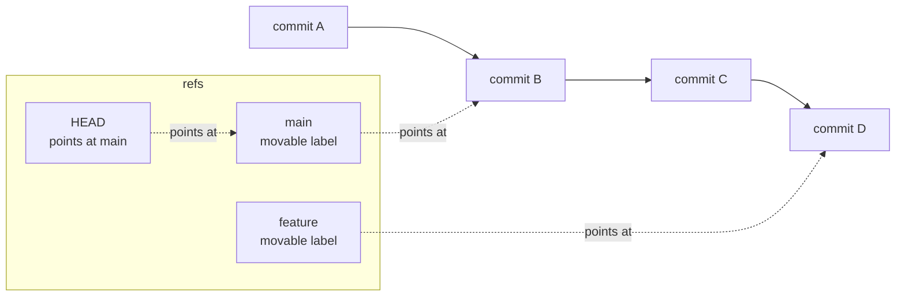

# Branches Are Movable Labels, Not Copies

> You can create, switch, and delete a branch without the repository noticing
> any of it — and you can move one backwards after the fact.

**Type:** Learn
**Prerequisites:** Phase 00, Lesson 2; Phase 02, Lesson 12
**Time:** ~35 minutes

---

## Learning Objectives

- Explain what a branch is in one sentence that has no "copy" in it
- Create, switch, rename, and delete branches without fear of data loss
- Move a branch pointer deliberately and say what that does to history
- Use `git switch` instead of `git checkout` for day-to-day work, and say why

---

## The Problem

You are three commits into an experiment. The experiment is wrong. You want
`main` back and the experiment out of the way.

The instinct is `git checkout main`, then... something with `branch -D` that you
are afraid of, because the last time you deleted a branch in a panic you spent
an evening reconstructing work that was, at the time, unrecoverable.

Then later: a long-running feature branch finishes. The reviewer asks for the
three middle commits to be squashed before merge. You have to move that branch.
It feels like rearranging furniture in a building you are standing in.

Both stalls come from the same wrong picture — that a branch is a copy of the
project, expensive to create and awkward to rearrange. It is not a copy. It is
a bookmark.

---

## The Concept

**A branch is a file containing one commit hash.** That is the entire
implementation. When you see a branch pointer in `git log`, that is the whole
truth.



Each label points at a commit. Commits point at their parent. Nothing is copied
when you create a branch — you write 41 bytes into a file.

```bash
git branch feature              # writes a label. Instant.
git switch feature              # moves HEAD. Instant.
git log --oneline --graph --all # the picture
```

Two facts fall out of this and they change how you work:

**Moving a label changes history's shape, not its content.** Commits are
immutable. But which commit the label names is a choice, and you can change it
at any time — `git branch -f feature main`, `git reset --hard`, `git rebase`.
That is what makes squashing and rebasing possible at all.

**Deleting a branch deletes a label, not work.** The commits stay in the object
store. What you lose is the *name* — and if the commits are unreachable from any
branch, they eventually get garbage-collected. So `git branch -d` refuses when
the branch holds unmerged commits, and that refusal is protecting something
real, not being fussy.

```bash
git branch -d feature     # refuses if unmerged — this is the safe one
git branch -D feature     # deletes anyway; commits survive until gc, then may not
```

`HEAD` is itself a label, and it usually points at a branch. Detached HEAD means
it points straight at a commit — you are not on any branch, and a commit made
there is harder to find later.

### Use `switch`, not `checkout`

`git checkout` does two unrelated jobs: move between branches *and* restore
files from a commit. That dual meaning is why `git checkout main -- file` and
`git checkout main` are so easily confused. `git switch` only changes branches;
`git restore` only touches files. Split jobs, split commands.

> **The reframe:** a branch is a bookmark, not a photocopy — which means
> creating one is free, moving one is a decision you can always reverse, and
> deleting one only ever deletes the bookmark.

---

## Build It

### 1. Create a branch and time it

```bash
cd ~/git-drill
time git switch -c feature
git branch -v
```

✅ You pass when a branch named `feature` appears in `git branch -v` and the
command returned instantly.

### 2. Prove it is a label

```bash
cat .git/refs/heads/feature
```

It is one line: a commit hash.

✅ You pass when you can read the hash out of the file and match it against
`git rev-parse feature`.

### 3. Move it and see what that means

```bash
git switch feature
printf 'two\n' > d.txt && git add d.txt && git commit -m "add d"
git switch main
git branch -f feature main     # label now points where main points
git log --oneline feature -1
```

The commit still exists — reachable through the reflog, not through the branch.

✅ You pass when `git log --oneline feature -1` now shows main's commit, and
`git reflog` still lists the commit you moved away from.

### 4. Delete, then find it again

```bash
git branch -d feature
git reflog            # the commit is still listed here
```

✅ You pass when the delete succeeds and the reflog still shows the commit you
just orphaned.

### 5. Meet detached HEAD

```bash
git switch --detach HEAD
git status            # says "HEAD detached at ..."
```

✅ You pass when `git status` reports a detached HEAD and you can say what
would make a commit made here hard to find later.

---

## Use It

| Command / concept | When you reach for it |
|---|---|
| `git switch -c <name>` | Starting isolated work |
| `git switch <name>` | Moving between branches |
| `git switch -` | Jumping back to where you were |
| `git branch -v` | Seeing every label and what it points at |
| `git branch -d` | Cleaning up a merged branch |
| `git branch -D` | Deleting an unmerged branch — commits survive in reflog until gc |
| `git branch -f` | Moving a label deliberately |
| Detached HEAD | You are on a commit, not a branch. Most commits made here are findable only via reflog |
| `git reflog` | "Where was that branch?" — the local record of every HEAD move |

---

## Exercises

1. Create three branches in a row from the same commit. List them.
   ✅ You pass when all three appear in `git branch -v` pointing at the same
   hash, and `git log --oneline --graph --all` shows no duplicated commits.

2. Move a branch you have already pushed to two commits behind `main`, then put
   it back. Find every command you used afterwards.
   ✅ You pass when you have the branch back where it started and you can name
   the reflog command that would have found it if you had not.

3. Delete a branch holding real unmerged commits with `-d`, then with `-D`.
   Record what each command said.
   ✅ You pass when you have both messages and can say why the first refused.

---

## Key Terms

| Term | What people say | What it actually means |
|---|---|---|
| branch | "a copy of the project" | A file containing one commit hash. Creating it copies nothing. |
| HEAD | "my current branch" | A label that usually points at a branch. Points at a commit directly = detached HEAD. |
| detached HEAD | "broken git" | HEAD points straight at a commit. Valid, but commits made here are only reachable via reflog. |
| `git branch -d` | "delete a branch" | Deletes the label. Refuses if the branch holds unmerged commits. |
| `git branch -D` | "force delete" | Deletes the label anyway. Commits survive until garbage collection, then may not. |
| reflog | "undo for branches" | Local record of every HEAD and branch move. Your first stop when a branch "disappeared". |
| `git switch` | "checkout but better" | Moves between branches only. `restore` handles files. |

---

## What this lesson skipped

**Detached HEAD workflows in depth.** Checking out a specific commit to
bisect a bug is real and useful — it arrives with Phase 17's operational
material, not here.

**Worktrees.** A worktree gives a second working folder on a second branch
without switching. The word contains "working tree" and that is exactly what it
manipulates. Phase 16 is dedicated to it; mentioning it here would be a forward
reference.

**Remote-tracking branches.** `origin/main` is a different animal from `main` —
it is a record of what the remote had last time you fetched. Lesson 18.