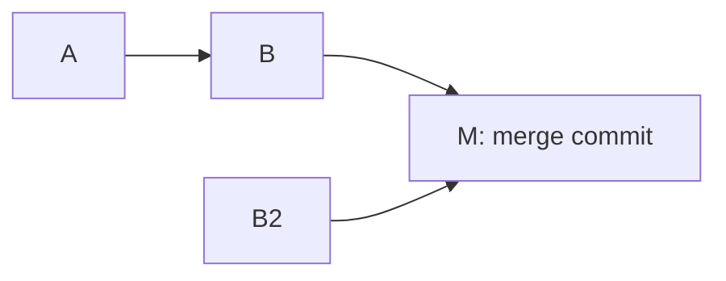
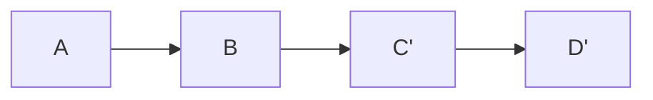

# Merge and Rebase

> You can tell the difference between "combining two lines of work" and
> "pretending they were one line all along" — and pick deliberately.

**Type:** Learn
**Prerequisites:** Phase 02, Lessons 12 and 13
**Time:** ~40 minutes

---

## Learning Objectives

- Distinguish a merge, a fast-forward, and a rebase by what they produce
- Rebase a feature branch onto an updated `main` and read the result
- Apply the rule that decides merge vs rebase for a given branch
- Recover from a rebase you did not mean to run

---

## The Problem

`git pull` gave you a graph you do not understand: a merge commit in the middle
of your feature branch, a row of duplicate-looking hashes, and a message that
says "Merge branch 'main' into feature". You cannot tell what happened, so you
cannot undo any of it.

Worse: you pushed that branch. A colleague rebased the same branch, pushed it,
and now you have two histories that share commits but not hashes. Merging both
into `main` gives you every change twice.

Nobody chose any of this. `git pull` did it by default, and the default is not
a decision you made.

---

## The Concept

Both commands answer the same question — *how do I combine two lines of work?*
They disagree about what the answer should look like afterwards.

**Merge** keeps both lines and records the join:



History shows that two lines existed and were combined. Nobody's commits are
rewritten, so a merge is safe on shared history.

**Rebase** moves your commits to sit on top of the other line, as if you had
written them there:



Your commit `C` is replaced by a new commit `C'` with the same message and the
same change, but a different parent — so a different hash. That is why rebasing
a pushed branch hurts people: their `C` and your `C'` are unrelated objects, and
merging both applies the change twice.

**Fast-forward** is the case where merge needs no merge commit: the other line
has not moved away, so your label just slides forward. Git takes it
automatically, and it is the reason a branch that has never been shared merges
with no merge commit at all.

```bash
git merge main     # combine, keep both lines, add a merge commit if needed
git rebase main    # replay my commits on top of main
```

### The rule

> **Rebase a branch you own. Merge a branch anyone else has.**

Rebase is private history editing, and it is the right tool for a branch that
exists only on your machine. Once a branch is pushed and someone else has it,
their history is a fact about the world; rewriting your copy of it creates two
incompatible versions of the same change. Merge instead.

For a repo you work on alone, and for a repo you are the only author of, the
real reason to prefer rebase is readability: a linear history is easier to scan,
`git bisect` works, and "which of these six commits is the bug" has a sensible
answer.

### Pull is two commands

`git pull` = `git fetch` + (`git merge` | `git rebase`). Say which one you mean:

```bash
git pull --rebase      # your commits land on top, no merge commit
git pull --no-rebase   # merge commit, if there is anything to merge
```

Whichever you pick, be the one who picked it.

### Undoing a rebase

If a rebase goes wrong and you have not pushed:

```bash
git rebase --abort      # while in progress
git reflog              # after it finished — find the pre-rebase position
git reset --hard HEAD@{1}
```

Lesson 16 covers this properly. The one-line answer here: the reflog still has
your old commits, because nothing was deleted.

> **The reframe:** merge says "these two things both happened, and here is a
> commit that says so"; rebase says "pretend this branch had been written after
> that one all along" — which is a lie you may only tell about history nobody
> else has seen.

---

## Build It

### 1. Make two lines of history

```bash
cd ~/git-drill
git switch -c feature
printf 'feature\n' > feature.txt && git add feature.txt && git commit -m "feature work"
git switch main
printf 'main\n' > main.txt && git add main.txt && git commit -m "main work"
git log --oneline --graph --all
```

Two lines. No join yet.

✅ You pass when the graph shows two separate commits with no merge node.

### 2. Merge and see the join

```bash
git switch feature
git merge main
git log --oneline --graph
```

A merge commit appears with two parents. Both lines survive.

✅ You pass when `git log --oneline` on feature shows the merge commit and both
original commits are still present in history.

### 3. Undo the merge without losing anything

```bash
git reset --hard HEAD~1
git log --oneline
```

✅ You pass when you are back on a single line with the pre-merge history
intact, and you can say why `reset --hard` was safe here (nothing of yours was
in the merge commit).

### 4. Rebase instead

```bash
git rebase main
git log --oneline --graph
```

Linear. "feature work" sits on top of "main work". No merge commit.

✅ You pass when the graph is a straight line and there is no merge node.

### 5. Watch the hashes change

Before the rebase, note the hash of `feature work` (`git log --oneline` on
feature). After, note it again.

✅ You pass when the hash is different and you can say exactly which field
changed — the parent — and why that makes the two commits different objects.

### 6. Try it both ways and compare

```bash
git switch -c experiment main
git merge feature      # merge commit, both lines visible
git switch -c experiment2 main
git rebase feature     # linear
git log --oneline --graph --all
```

✅ You pass when you have both pictures side by side and can say which one you
would rather review.

---

## Use It

| Command / concept | When you reach for it |
|---|---|
| `git merge <branch>` | Combining shared history, or keeping both lines visible |
| `git rebase <branch>` | Updating a private branch on top of newer work |
| `git pull --rebase` | Pulling without a merge commit, deliberately |
| `git pull --no-rebase` | Pulling with a merge commit, deliberately |
| Fast-forward | When the other branch has no new commits of its own — no join needed |
| Merge commit | Two parents. Says "these lines were combined" |
| `git rebase --abort` | A rebase in progress went sideways |
| The rule | Rebase what you own, merge what others have |

---

## Exercises

1. Take one real branch you have not pushed. Rebase it onto `main`. Compare
   `git log --graph --oneline` before and after.
   ✅ You pass when you have both graphs and can name what a reviewer would find
   easier in the rebased one, and what they would lose.

2. Merge that same branch instead. Check whether git created a merge commit or
   fast-forwarded, and say which happened and why.
   ✅ You pass when you can say which of the two outcomes you got and name the
   condition that decided it.

3. Rebase a branch that you pushed yesterday and someone else has pulled.
   Describe, in writing, what a teammate would experience if they then merged
   both copies of your branch into `main`.
   ✅ You pass when your description names duplicate changes appearing twice, and
   you can point at the rebase as the cause.

---

## Key Terms

| Term | What people say | What it actually means |
|---|---|---|
| merge | "joining branches" | Combine two lines and record the join. Adds a merge commit with two parents when needed. |
| rebase | "cleaning up history" | Replay your commits on another base. New hashes, same changes. Safe only on history nobody else has. |
| fast-forward | "a merge" | A merge where one line has no new commits, so the label just slides. No merge commit. |
| merge commit | "the merge" | A commit with two parents. The explicit record that two lines joined. |
| `git pull` | "getting the latest" | `fetch` plus a merge or rebase you did not choose. Use `--rebase` / `--no-rebase`. |
| rebasing shared history | "fixing the branch" | Produces two incompatible versions of the same commits. Every later merge sees the change twice. |
| `git rebase --abort` | "undo" | Bails out of an in-progress rebase. Nothing was committed yet. |

---

## What this lesson skipped

**Interactive rebase (`git rebase -i`).** Squashing, reordering, rewording
commits. It is the same mechanism plus an editor, and it earns its own practice
when you are cleaning up your own unpushed work — Phase 16's territory.

**Merge strategies beyond fast-forward and recursive.** `ours`, `octopus`, and
subtree merges exist. Nothing in this course needs them.

**Bisect.** `git bisect` finds a bad commit by binary search — far easier once
history is linear, which is the argument this lesson made. It arrives with
debugging material later.