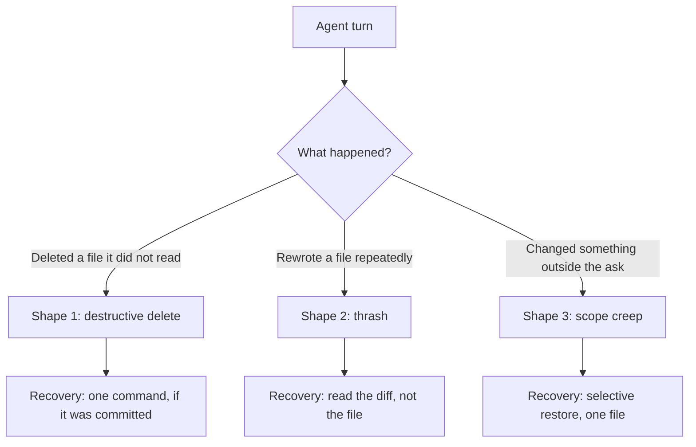

# Stashing, and Why Agents Break Things

> You can park half-finished work without committing it, and you can recognise
> the three ways an agent damages a repo before it does.

**Type:** Learn
**Prerequisites:** Phase 02, Lessons 12, 16; Phase 01, Lesson 10
**Time:** ~40 minutes

---

## Learning Objectives

- Park half-finished work, switch branches, and get it back intact
- Choose `pop` or `apply` deliberately, and know when `-u` is required
- Recognise the three shapes of agent damage: delete, thrash, scope creep
- Recover each shape with the smallest command that works

---

## The Problem

You are halfway through a change. It is not committable — it is half-wired and
the build does not pass. You need to switch branches to chase something else.

`git switch main` refuses: your working tree has changes that would be lost.
Your options look like three bad ones. Commit the broken state (pollutes
history), finish the change (you do not know how), or abandon it.

So you do nothing, and you lose twenty minutes.

That is the stash-shaped problem. Stash solves it in one command.

The second half of this lesson is stranger. An agent working in your folder can
delete a file it has never read, overwrite a config it misunderstood, or rewrite
the same file eleven times in one turn. None of these are exotic — they are
what a loop does when the tool it holds is "write to this path". Once you know
the three shapes, they stop being surprises.

---

## The Concept

### Stash: park work without committing it

`git stash` takes your uncommitted changes out of the working tree and stores
them as a commit on a hidden branch. The folder returns to the last commit. Your
work is still there, one command away.

```bash
git stash                 # park everything uncommitted
git switch main           # now it works
# ... do the other thing ...
git switch back
git stash pop             # put it back and drop the stash entry
```

`pop` restores and deletes the entry. `apply` restores and **keeps** the entry —
the right choice when the restoration conflicted, because you get another chance
without having lost the copy.

| Command | Restores | Deletes the stash entry |
|---|---|---|
| `git stash pop` | Yes | Yes |
| `git stash apply` | Yes | No — keep it until you have checked |
| `git stash list` | — | Shows every entry |
| `git stash show -p stash@{0}` | Diffs the entry | No |
| `git stash branch fix-x` | Yes, as a new branch | Yes, and commits the work there |

Two limits worth knowing before you need them under pressure:

**Stash does not carry untracked files by default.** A new file that was never
committed is *not* stashed by a plain `git stash`, and comes back as a conflict
or not at all. `git stash -u` includes untracked files. This is the most common
stash surprise, and it is the one that costs you an agent's new files.

**A stash entry is not a backup you can forget about.** It is a commit on a
branch with no name, and it is subject to garbage collection like anything
else. Treat an unrecovered stash as work you have not actually saved.

### Why agents break things

Phase 01, Lesson 10 established the agentic loop: the model decides, a tool
executes, the result returns. The tool here is the filesystem, and it does not
care what the file meant.

Three shapes, and they are all mechanical:



**Shape 1 — destructive delete.** An agent deletes a file it never read,
reasoning that it is unused. `git status` shows it immediately. `git checkout --
<file>` puts it back, *if* it was committed.

**Shape 2 — thrash.** The agent rewrites the same file across several edits
inside one turn. The final state might be right, might be worse than the middle.
The only way to see the path is `git diff` — the final file tells you nothing
about whether it improved.

**Shape 3 — scope creep.** It changed a config, a lock file, and a "small
unrelated fix" alongside the ask. `git status` names every file. That is how you
notice, which is why `git status` before every agent run is not superstition.

### The protocol that follows from this

The three shapes share one weakness: they are all cheap to undo *if* the last
known-good state was committed, and expensive if it was not.

```bash
git status              # is it clean?
git add -A && git commit -m "before: <what the agent is about to do"
# hand over the folder
git status              # what did it actually touch
git diff                # what did it actually change
```

Committing before handing over a folder is the single habit that makes agents
safe to use. It costs one command and it converts every failure above from a
loss into a review.

> **The reframe:** stashing is not about hiding work, it is about giving work a
> place to live that isn't the working tree — and an agent is only reversible in
> proportion to whether you committed before letting it loose.

---

## Build It

### 1. Park half-finished work

```bash
cd ~/git-drill
git switch -c half-done
printf 'work in progress\n' > wip.txt
git add wip.txt
git switch main        # this succeeds, because nothing is committed
git status             # clean
```

Note: `wip.txt` is committed here so the stash is simple. Step 4 shows the
untracked case.

✅ You pass when the switch succeeded and `git status` is clean on `main`.

### 2. Come back and get it

```bash
git switch half-done
git status
```

✅ You pass when `git status` shows `wip.txt` staged, exactly as you left it.

### 3. Stash something genuinely uncommitted

```bash
printf 'experiment\n' >> wip.txt        # unstaged edit
printf 'brand new\n' > untracked.txt    # never added
git stash                              # note: does not take untracked.txt
git status                             # untracked.txt still there
git stash pop
git status
```

✅ You pass when `untracked.txt` survived the stash untouched, and `wip.txt`'s
edit came back — and you can now say which files a plain `git stash` misses.

### 4. Stash everything, including new files

```bash
git stash -u
git status             # genuinely clean now
git stash pop
```

✅ You pass when `untracked.txt` is inside the stash and comes back with the
rest.

### 5. Apply instead of pop

```bash
git stash
git stash apply
git stash list         # the entry is still there
git stash drop
```

✅ You pass when `git stash list` showed the entry after `apply`, and `git stash
drop` removed it.

### 6. Recover from an agent-shaped failure

Simulate all three shapes in a scratch repo, committing before you start.

```bash
git add -A && git commit -m "before agent"
rm important.txt                      # shape 1
printf 'something else\n' >> config   # shape 2
printf 'unrelated\n' > random.txt     # shape 3
git status
git diff
git checkout -- important.txt         # one file, not the whole tree
git status
```

✅ You pass when `important.txt` is back and `git status` still shows the other
two changes — a selective restore, not a nuke.

---

## Use It

| Command / concept | When you reach for it |
|---|---|
| `git stash` | Parking uncommitted changes to switch branches |
| `git stash -u` | Same, but includes files that were never added |
| `git stash pop` | Restoring, and clearing the entry |
| `git stash apply` | Restoring, keeping the entry — use when it conflicted |
| `git stash list` | "Where was that?" — entries are commits too |
| `git stash branch <name>` | Turning a stash into a real branch so you can commit on it |
| `git checkout -- <file>` | One file back, everything else left alone |
| Commit before handover | Before any agent run. Makes every failure reversible. |
| `git status` after | What it actually touched |
| `git diff` after | What it actually changed, including thrash |

---

## Exercises

1. Start a real change, get halfway, stash with `-u`, switch to `main`, do
   something unrelated, and come back. Time it.
   ✅ You pass when the work came back intact and you have a time in seconds —
   if it took under thirty seconds, the "I can't switch branches" feeling is
   gone for good.

2. Simulate all three agent shapes in a scratch repo. Commit before you start.
   Recover each one with the *smallest* command that works, not `reset --hard`.
   ✅ You pass when you used `checkout -- <file>` or `stash` for at least two of
   them, and you can say why the third needed something different.

3. Write the four-line protocol from the Concept section into a place you will
   actually run it — a shell alias, a script, a note in `CLAUDE.md`.
   ✅ You pass when the protocol exists somewhere outside this lesson, and you
   have used it once on a real agent run.

---

## Key Terms

| Term | What people say | What it actually means |
|---|---|---|
| stash | "hiding my work" | A commit on a hidden branch holding uncommitted changes. Restorable, and subject to gc. |
| `git stash -u` | "stash" | The variant that also takes files never added to git. The plain one skips them. |
| `pop` vs `apply` | "the same" | `pop` restores and deletes the entry; `apply` keeps it. Keep it when the restore conflicted. |
| working tree | "my files" | The live folder. The only place uncommitted work exists, and the only thing `reset --hard` can destroy. |
| destructive delete | "the agent cleaned up" | An agent removed a file it never read. Cheap to undo *if* committed. |
| thrash | "it iterated" | Multiple rewrites of one file in a turn. Only the diff shows whether it improved. |
| scope creep | "it helped while it was there" | Changes outside the ask. `git status` is the only reliable detector. |

---

## What this lesson skipped

**Worktrees.** The real answer to "I want two agents in two folders at once".
The word contains "working tree" because it is exactly that — a second working
folder on a second branch. Phase 16 is dedicated to it, and it is the right tool
whenever the problem is *concurrent* work rather than *interrupted* work.

**`git stash` workflows with rebase and pop conflicts.** Stashing, rebasing,
and popping onto a changed tree can conflict three ways. Recoverable, but rare —
and the recovery is `git stash list` plus patience.

**Hooks that block destructive agent commands.** The tool exists (`PreToolUse`
hooks intercept writes). It is Phase 08, and it depends on concepts this course
has not established yet.